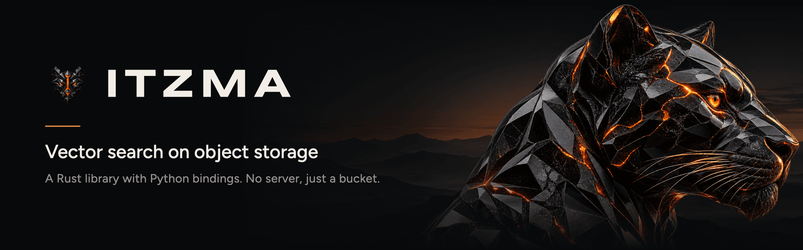

<picture>
  <source media="(prefers-color-scheme: dark)" srcset=".github/assets/banner-dark.png">
  <source media="(prefers-color-scheme: light)" srcset=".github/assets/banner-light.png">
  
</picture>

[](https://github.com/sergiommarcial/itzma/actions/workflows/ci.yml)
[](https://crates.io/crates/itzma-core)
[](https://docs.rs/itzma-core)
[](https://pypi.org/project/itzma/)
[](https://pypi.org/project/itzma/)
[](#license)

# Itzma

Itzma is vector retrieval on top of object storage, written in Rust, with Python bindings. Vectors are stored as plain objects in a bucket. There is no server between the caller and the data: any process that can reach the bucket can write, and any process can query. Correctness rests on two things the object store already does, put-if-absent and conditional update.

It is a library. You embed it in your process, open a namespace, and S3 (or a local directory, or memory) holds the data.

- [What it does](#what-it-does)
- [Quick start](#quick-start)
- [Concepts](#concepts)
- [Writing](#writing)
- [Querying](#querying)
- [Filtering](#filtering)
- [Indexing](#indexing)
- [Compaction, garbage collection and maintenance](#compaction-garbage-collection-and-maintenance)
- [Caching and read budgets](#caching-and-read-budgets)
- [Looking inside a namespace](#looking-inside-a-namespace)
- [Guarantees](#guarantees)
- [Storage layout and formats](#storage-layout-and-formats)
- [Errors](#errors)
- [Storage backends](#storage-backends)
- [Limits](#limits)
- [Develop](#develop)

## What it does

- Namespaces with a fixed dimension and metric (L2, cosine, dot product).
- Dense vector search, exact or through an index: HNSW (the default) or SQ8 with clustered partitions.
- Sparse vectors (term id, weight) beside the dense one, with an exact sparse query and an optional inverted index.
- Typed attributes, declared at create, and filtering on them, alone or narrowing a vector query.
- Batched upserts and deletes, safe with many concurrent writers, with optional idempotency keys.
- S3 (and anything else `object_store` supports), local disk and in-memory stores.
- Compaction, garbage collection and manifest recovery.
- A RAM and NVMe read cache and a cache of decoded structures.
- Rust and Python APIs; NumPy and Arrow input in Python.
- A read-only health report and a byte budget on every read.

## Quick start

Rust: add `itzma-core` from crates.io. Python: `pip install itzma` (wheels for macOS and Linux, Python 3.10 and later; see [py-itzma](py-itzma/README.md)). This example uses the in-memory store.

```toml
[dependencies]
itzma-core = "0.1"
object_store = "0.14"
tokio = { version = "1", features = ["macros", "rt-multi-thread"] }
serde_json = "1"
```

```rust
use std::sync::Arc;

use itzma_core::{AttrSchema, AttrType, Document, Metric, Namespace, Schema};
use object_store::memory::InMemory;

#[tokio::main]
async fn main() -> itzma_core::Result<()> {
    let store = Arc::new(InMemory::new());

    // Dimension, metric and the type of every attribute are fixed for the life
    // of the namespace.
    let schema = Schema::new(3, Metric::Cosine)
        .with_attrs(AttrSchema::new().field("title", AttrType::Text));
    let ns = Namespace::create(store.clone(), "articles", schema).await?;

    // One call is one atomic write. It returns the sequence number.
    let seq = ns
        .upsert(vec![
            Document {
                id: "intro".into(),
                vector: vec![0.9, 0.1, 0.0],
                attrs: Some(serde_json::json!({ "title": "Introduction" })),
                sparse: None,
            },
            Document {
                id: "faq".into(),
                vector: vec![0.0, 1.0, 0.2],
                attrs: None,
                sparse: None,
            },
        ])
        .await?;
    assert_eq!(seq, 1);

    // Closest first. Lower distance means closer, for every metric.
    let hits = ns.query(&[1.0, 0.0, 0.0], 2).await?;
    assert_eq!(hits[0].id, "intro");

    ns.delete(vec!["faq".into()]).await?;

    // Another handle, possibly in another process, sees the same data.
    let other = Namespace::open(store, "articles").await?;
    assert_eq!(other.query(&[0.0, 1.0, 0.0], 5).await?.len(), 1);
    Ok(())
}
```

The same in Python (build it with `make py-dev`, see [py-itzma/README.md](py-itzma/README.md)):

```python
import itzma
from itzma import attr

store = itzma.Store("memory://")  # or "file:///var/lib/itzma", "s3://bucket/prefix"
schema = itzma.Schema(dim=3, metric=itzma.Metric.COSINE, attrs={"year": itzma.AttrType.NUMBER})
ns = itzma.Namespace.create(store, "articles", schema)

ns.upsert([
    {"id": "intro", "vector": [0.9, 0.1, 0.0], "attrs": {"year": 2024}},
    {"id": "faq", "vector": [0.0, 1.0, 0.2], "attrs": {"year": 2021}},
])
hits = ns.query([1.0, 0.0, 0.0], top_k=2, filter=attr("year") >= 2022)
print(hits.ids, hits.distances)
```

Writes also take NumPy arrays (`ids=`, `vectors=`, `attrs=`) and Arrow, Polars or DuckDB tables.

## Concepts

**Namespace.** A collection of documents that share a schema. On storage it is a key prefix, `<id>/`. Ids match `[a-z0-9_-]{1,64}`. A namespace is created explicitly with `Namespace::create`, since its dimension and metric must be declared first.

**Document.** An `id` (any string of 1 to 512 bytes), a `vector` and optional `attrs`, a JSON object whose fields the schema declares. Upserting an existing id replaces the whole document.

**Schema.** `{ dim, metric, attrs }`. Every vector written or queried must have exactly `dim` finite components; under cosine an all-zero vector is refused too. The schema lives in the manifest and again in `schema.json`, which is written once and never changed, so losing the manifest does not lose it.

**WAL entry.** One `upsert` or `delete` call becomes one entry in the write-ahead log, committed as a whole. Entries are numbered 1, 2, 3, and so on.

**Manifest.** The one object that is ever overwritten. It holds the schema, the live segments, how far the WAL has been folded into them, and which segments have an index.

**Segment.** An immutable object holding the live documents and deletions of a range of WAL entries, named by that range. A query reads the segments plus the WAL entries not folded yet (the tail).

**Handle.** A `Namespace` value holds the store, the id, the schema and a few hints. It holds no lock, so any number of handles, in one process or many, can work on one namespace.

## Writing

`upsert(docs)` and `delete(ids)` validate everything first, so one bad document refuses the whole call with nothing written. Then the batch is written as one object with put-if-absent at the next sequence number. If another writer took that number, the writer looks past it and tries again, up to 32 times (`WriteContention`). There is no coordinator, lock or leader.

A batch is one object and is refused above 64 MiB uncompressed (`BatchTooLarge`). Split bigger loads into several batches; each is atomic, the whole is not.

A write that fails after the request was sent may or may not have landed. A plain retry can append it twice, which is harmless for the end state of upserts and deletes but can overwrite a newer write to the same id. For loads that must land once, use the keyed forms, `upsert_keyed` and `delete_keyed`, with a `WriteKey`: `WriteKey::new(key)` on the first attempt, `WriteKey::retry(key, from)` on a retry, which looks for the key from sequence `from` on and returns the original's sequence number if it finds it.

Columnar input: `upsert_columns` takes a `DocColumns` (ids, a row-major `f32` matrix, typed attribute columns) as one batch, and `upsert_stream` takes a stream of them, cut into objects of about `StreamOptions::target_bytes` and written in order. A failed stream reports how much landed. The Python bridge uses these for Arrow input.

## Querying

`query(vector, top_k)` returns up to `top_k` hits, closest first, each with its id, distance and attributes. `query_with` takes `QueryOptions`:

- `rerank` (default `Some(4)`): an index proposes `rerank * top_k` candidates, which are then rescored against their exact vectors. `None` proposes every row.
- `nprobe` (default `None`, chosen from the index): how many SQ8 partitions to read, or under HNSW a multiplier on how wide the graph search is.
- `exact` (default `false`): skip indexes and scan every live document.
- `filter`: a `Predicate` the hits must match.

Each segment with an index proposes candidates through it; segments without one and the WAL tail are scanned. A candidate that a newer segment or the tail overwrote or deleted is dropped, the survivors are reranked on exact vectors, and the closest `top_k` across all sources win. The answer never carries an approximate distance.

Distances: L2 is squared Euclidean, cosine is `1 - cos`, dot product is negated, so lower is closer for all three. Distances are comparable only within one query.

## Filtering

Attribute fields are declared at create, each with a type: `Bool`, `Number`, `Text`, `TextSet` or `NumberSet`. Writes are checked against the schema: an undeclared field is `UnknownAttr`, a wrong type `AttrTypeMismatch`. `null` is allowed for any field.

`Predicate` is a typed tree: `And`, `Or`, `Not`, null and boolean tests, number comparisons, `In` lists and ranges, text comparisons, and set tests (`Contains`, `ContainsAny`, `ContainsAll`, `IsEmpty`). A comparison against a null or missing field is false, and `Not` flips it.

`Namespace::filter(&predicate, &FilterOptions)` returns matching rows in id order, a page at a time (`limit` 1 to 10,000, default 100; pass the returned `next` as `after` for the next page). It reads no vectors. Paging is not a snapshot.

A filter on `query_with` is applied after shadowing, and a source short of matches is asked again for more, so the answer is the true filtered top `top_k`, short only when fewer documents match.

## Indexing

`Namespace::index(&IndexOptions)` builds an index for each live segment with at least `min_rows` rows (default 4,096) that has none yet, and publishes it in the manifest. Neither `compact` nor `maintain` builds indexes, so schedule `index` after them (the Python maintainer can run it for you). `IndexOptions::kind` picks the kind; a namespace can hold both, and a rebuild can switch one segment's kind.

**HNSW** (`IndexKind::Hnsw`, the default) is a graph over one-byte-per-dimension codes. A query fetches a segment's whole index object in one request, then walks the graph out of those bytes, so it is cheap once the object is warm in a cache and costs one larger read cold. It takes longer to build than SQ8. At 32 segments it gave recall@10 of 0.987 on SIFT1M and 0.984 on GloVe-25.

**SQ8** (`IndexKind::Sq8`) stores each vector as one byte per dimension and reads only the partitions a query probes, which suits uncached reads. Segments of 100,000 rows or more are clustered into about `sqrt(rows)` partitions (`IndexOptions::nlist` overrides), and a query reads about `2 * sqrt(nlist)` of them by default. On SIFT1M and GloVe-25 the defaults gave recall@10 of 0.99 or more. `rebuild: true` builds again over existing indexes. An index needs `segment_format` 2 or above.

## Sparse vectors

A document can carry a sparse vector beside its dense one: `Document::sparse`, a list of `(term id, weight)` pairs, optional per document, nothing declared per namespace. Term ids must not repeat and weights must be finite; at most 65,535 terms per document.

`Namespace::query_sparse(&terms, top_k, &SparseQueryOptions)` is exact and standalone: the score is the dot product, `Hit.distance` its negation, ties broken by id. It takes a `filter` like `query_with`. Shadowing across segments and the tail works as for dense queries.

`Namespace::index_sparse(&IndexSparseOptions)` builds an inverted index per segment (`sparse-idx-<n>.bin`), so a query reads only its own terms' postings instead of every sparse vector. The answer is the same with or without it.

A batch with a sparse vector is written as WAL version 4 (5 with a key), which needs the namespace at WAL level 5. New namespaces start there; an older one needs `upgrade_wal_format(5)`.

## Compaction, garbage collection and maintenance

**`compact`** folds the WAL tail into a new segment and publishes it with one conditional manifest update. When there are more than `max_segments` (default 8) live segments, or one is at `max_segment_bytes` (default 128 MiB), it merges instead, into size-capped segments, streaming the inputs. A segment's bytes depend only on its WAL range, so a rerun after a crash writes the same object, and racing compactors cannot publish different answers. Compaction never deletes anything.

**`gc`** deletes segments that a merge or a later fold replaced, once they and their replacement are at least `min_age` old (default 24 hours), so readers still holding an old manifest have time to finish. With `fence_wal: true` it also replaces folded WAL objects with 8-byte fences, which keep put-if-absent working at their keys. WAL objects are never deleted. `dry_run` reports what it would do.

**`maintain`** is the one call to schedule (from cron, a loop, a worker): it compacts when the tail is long enough (64 objects, 64 MiB, or an optional age) or there are too many segments, then runs `gc`. The library starts no background task itself; the Python bridge has an optional maintainer.

**`recover`** writes a new manifest for a namespace that lost its own, from `schema.json`, the segment names and the WAL. It refuses if a manifest exists, and stops with `Unrecoverable` and the keys to restore if a range has no readable copy. It does not restore indexes; run `index` and `index_sparse` again.

**Format levels.** The manifest records the newest WAL and segment formats the namespace may hold. A build that reads less refuses the namespace before touching it. `upgrade_wal_format(level)` and `upgrade_segment_format(level)` raise a level, one way. New namespaces start at WAL level 5 and segment level 2; `upgrade_segment_format(3)` turns on the typed attribute columns of segment format 3.

## Caching and read budgets

**Read cache.** `CacheStore` wraps any store with a RAM tier and an optional NVMe tier, keyed by object and byte range. Give it to a handle with `Namespace::with_cache`; only queries read through it. The manifest is never cached, so a query always sees the latest writes. Objects are immutable once written, so there is no invalidation, only eviction.

**Decoded cache.** `DecodedCache` keeps parsed structures (segment directories, blocks, index heads and partitions, whole small segments) so a warm query skips decoding. Share one between handles with `Namespace::with_decoded_cache`. Default 256 MiB.

**Read budget.** Every query attempt, and each unit of a compaction, may read at most a byte budget (`DEFAULT_READ_BUDGET`, 1 GiB, or `Namespace::with_read_budget`). Past it the call fails with `ReadBudgetExceeded` before anything is written. An indexed segment is charged only for what it fetches, so a namespace bigger than the budget can still be queried once its large segments are indexed.

`configure_cpu` sizes the two thread pools CPU work runs on (queries on every core, maintenance on a quarter), once, before the first call that uses them.

## Looking inside a namespace

`inspect::report(store, id)` lists what a namespace holds (manifest, segments, indexes, WAL, fences) and what looks wrong, without changing anything. Damage is a line in the report; only a failing store is an error.

```bash
cargo run --example dump -- <namespace> --dir <path>
```

prints that report for a namespace on local disk and exits 1 if it found a problem.

## Guarantees

- **Durability.** Once `upsert` or `delete` returns, the write is in the object store.
- **Read your writes.** A query that starts after a write returned sees it, from any handle or process.
- **Atomic batches.** Readers see all of a batch or none.
- **Consistent prefix.** Readers see entries 1 through n, never a later entry without an earlier one.
- **Total order.** Concurrent writers get distinct sequence numbers; the higher one wins for the same id.
- **No lost manifest updates.** Every manifest change is a compare-and-swap, retried on fresh contents up to 32 times.
- **Compaction is invisible.** A query returns the same documents before, during and after a compaction, including when a compactor is killed or two race.
- **No partial writes on bad input.** Validation runs before any storage call.

Not guaranteed: exactly-once for plain writes (see [Writing](#writing)), and keyed writes do not stop two submits of one key running at the same time.

## Storage layout and formats

```text
<namespace>/
  schema.json                         dimension, metric, attribute types; written once
  manifest/current.json               live segments, fold point, indexes, format levels
  wal/00000000000000000001.json       one object per batch (binary despite the name)
  segments/<lo>-<hi>/data.bin         a segment, named by the WAL range it covers
  segments/<lo>-<hi>/index-<n>.bin    its dense index (HNSW or SQ8), generation n
  segments/<lo>-<hi>/sparse.bin       its sparse vectors, only if a document has one
  segments/<lo>-<hi>/sparse-idx-<n>.bin its sparse inverted index, generation n
  segments/<lo>-<hi>/generation       the highest index generation ever used
  gc/fenced-through                   a hint for gc, only with fence_wal
```

`schema.json` and the manifest are JSON. Everything else is binary and starts with a four-byte magic:

| Object | Magic | Versions |
|---|---|---|
| WAL batch | `ITZW` | 2, or 3 with an idempotency key; 4 and 5 add a sparse column; ZSTD-compressed when smaller |
| WAL fence | `ITZF` | 4 |
| Segment | `ITZS`, ending in `ITZE` | 2 (block-addressable, Bloom filter); 3 adds typed attribute columns and zone maps |
| Sparse vectors (`sparse.bin`) | `ITZS` | 1 |
| Index | `ITZI` | 1, kind 1 (SQ8) or 2 (HNSW) |
| Sparse index | `ITZP` | 1 |

A reader that meets a version or kind it does not know refuses it instead of guessing; a segment whose index kind is unknown is scanned flat.

## Errors

Every fallible call returns `itzma_core::Result<T>` with `ItzmaError`, which is `#[non_exhaustive]`. The library does not panic on bad input. The ones a caller usually handles:

| Variant | When |
|---|---|
| `NamespaceExists`, `NamespaceNotFound` | `create` on a taken id, `open` on a missing one |
| `DimensionMismatch`, `InvalidVector` | a vector of the wrong length, non-finite, or zero under cosine |
| `UnknownAttr`, `AttrTypeMismatch`, `InvalidAttrs` | attributes or a predicate that do not fit the schema |
| `InvalidQuery`, `InvalidId`, `InvalidKey`, `InvalidColumns`, `InvalidConfig` | bad arguments, refused before any storage call |
| `BatchTooLarge` | a batch over 64 MiB |
| `WriteContention`, `ManifestContention` | 32 lost races in a row; nothing was written |
| `KeyConflict` | a keyed retry found its key on a different batch |
| `ReadBudgetExceeded` | a read past the handle's budget |
| `WalFormatTooNew`, `SegmentFormatTooNew` | the namespace is at a level this build does not read; upgrade the build |
| `WalFormatTooOld`, `SegmentFormatTooOld` | the call needs a higher level; run the matching `upgrade_*` |
| `CorruptWal`, `CorruptSegment`, `CorruptIndex`, `CorruptSparseIndex`, `CorruptManifest` | an object is damaged or does not match; a query never falls back to a flat scan over a damaged index |
| `ManifestExists`, `Unrecoverable` | from `recover` |
| `Storage` | the backend failed |

## Storage backends

Anything that implements `object_store::ObjectStore` works: S3, GCS, Azure, local disk, memory. Itzma needs put-if-absent (writes, create) and conditional update (every manifest change: compaction, indexing, format upgrades). `InMemory` and S3 have both. `LocalFileSystem` has no conditional update, so on local disk you can create, write and query, but `compact`, `index` and the upgrades fail with a storage error.

The tests run against MinIO as well (`make test-s3`), which checks that conditional writes really are atomic under concurrent writers.

### Cloud adapters on the official SDKs

Three crates in this repository wrap the vendors' own Rust SDKs as an `ObjectStore`, for when you want the SDK's credentials, retries, timeouts and endpoints rather than `object_store`'s clients:

| Crate | Store | Build it from your client | Or from settings | Rust |
|---|---|---|---|---|
| `itzma-store-gcs` | Google Cloud Storage | `GcsStore::new(storage, control, bucket)` | `GcsStore::connect(bucket, GcsOptions)` | 1.91 |
| `itzma-store-azure` | Azure Blob Storage | `AzureStore::new(container_client)` | `AzureStore::connect(account, container, AzureOptions)` | 1.88 |
| `itzma-store-aws` | Amazon S3 and compatibles | `S3Store::new(client, bucket)` | `S3Store::connect(bucket, S3Options)` | 1.94.1 |

Without options, GCS uses Google's default credentials (Workload Identity on GKE and Cloud Run), Azure a managed identity, and S3 the AWS SDK's default chain. Put-if-absent and the manifest's conditional update map to each service's own condition (GCS generations, Azure and S3 ETags), so a lost race is always reported as one. They are released with `itzma-core`, at the same version:

```toml
itzma-store-gcs = "0.2"
```

A store counts as supported when it passes the conformance suite in `crates/itzma-store` (`itzma_store::conformance_tests!`). Each adapter runs it in CI against an emulator: storage-testbench for GCS, Azurite for Azure, MinIO for S3 (`make test-gcs`, `make test-azure`, `make test-aws`). The Python package builds on these adapters for `gs://`, `az://` and `s3://`.

## Limits

- A query without an index, or with `exact: true`, reads every live vector of the unindexed segments, bounded by the read budget.
- A clustered index is approximate unless `nprobe` reaches its partition count; recall is measured on SIFT1M and GloVe-25 only.
- Compaction and indexing are explicit; nothing runs them for you.
- Filtering without a vector scans ids and attributes until a page is full.
- Vector queries do not paginate.
- One batch is one object, at most 64 MiB.
- WAL objects are never deleted; fencing them is opt-in.
- Attribute fields cannot be added after create.

## Develop

`make help` lists the targets.

```bash
make install-tools    # once: cargo-deny and cargo-machete
make test             # unit, integration and doctests, each benchmark once
make test-fast TESTS="query filter"   # library unit tests plus the named files
make test-s3          # the tests against MinIO (needs docker)
make lint             # fmt, clippy, rustdoc, cargo-deny, cargo-machete
make py               # the Python bridge's checks (needs uv)
make ci               # what CI runs on stable
make bench            # timings, in-memory store
```

Requires Rust 1.87 or newer (edition 2024).

## Releases

The crate and the Python package share one version and are released together. Changes go under `[Unreleased]` in [CHANGELOG.md](CHANGELOG.md) as they land. To release, run the **Release** workflow from the Actions tab with `patch`, `minor`, `major` or an exact version (the first release is `0.1.0`, the version already in the manifests). It bumps the version, turns `[Unreleased]` into that version's notes, commits, tags `vX.Y.Z`, and starts **Publish**, which runs the full CI on the tag, builds the wheels and the sdist, publishes `itzma-core`, `itzma-store` and the three store adapters to crates.io and `itzma` to PyPI, and creates the GitHub Release. A failed Publish can be run again for the same tag; steps already done are skipped. `make package` builds the crate and the sdist locally without publishing.

## Contributing

See [CONTRIBUTING.md](CONTRIBUTING.md). Report security problems privately, as described in [SECURITY.md](SECURITY.md).

## License

Licensed under either of [MIT](LICENSE-MIT) or [Apache-2.0](LICENSE-APACHE), at your option.
